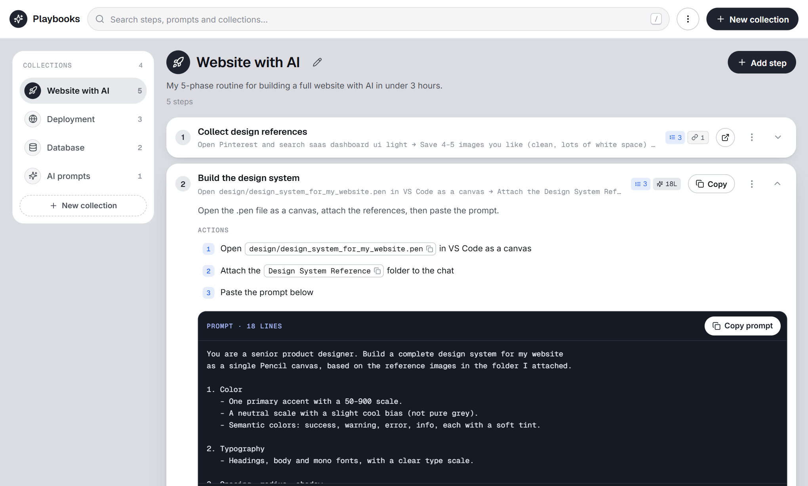
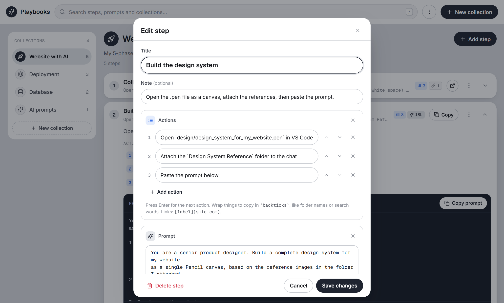
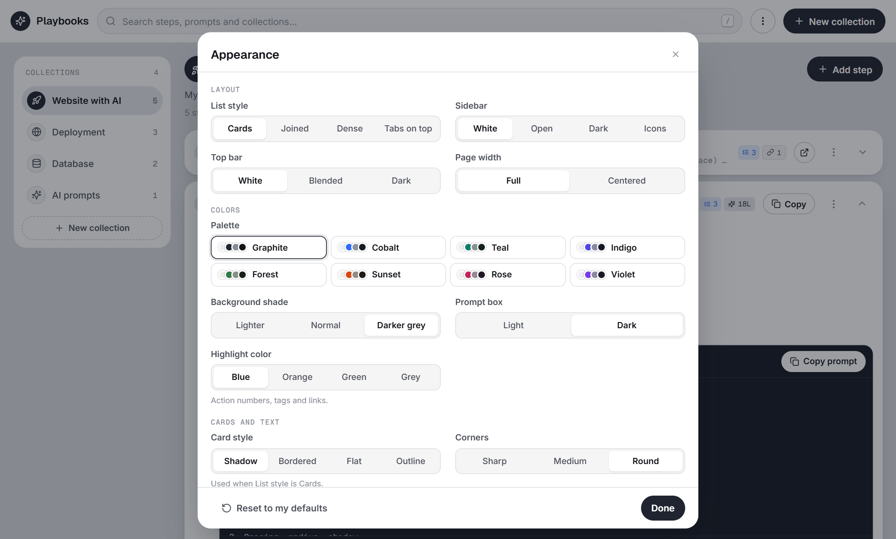
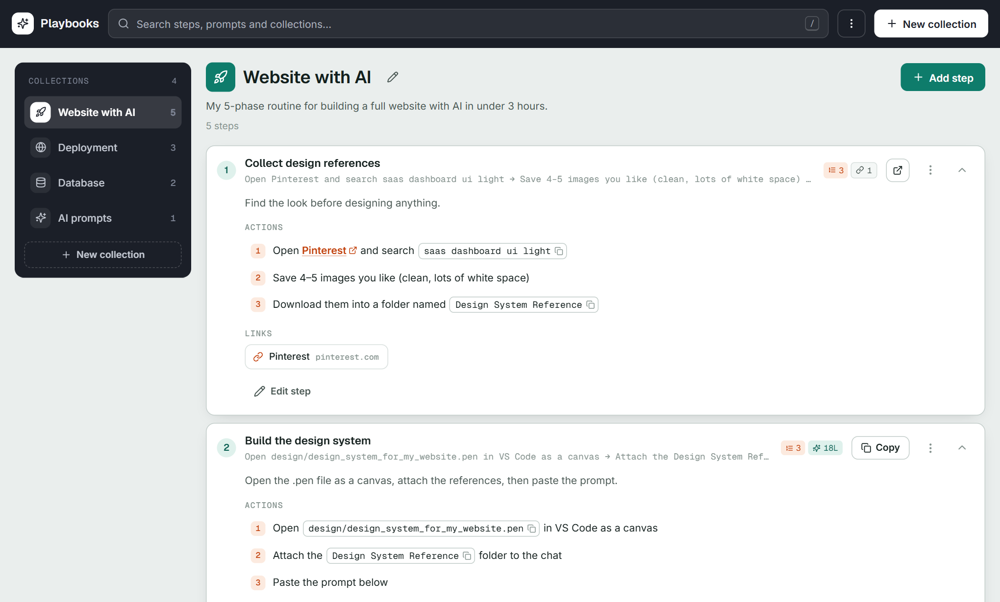
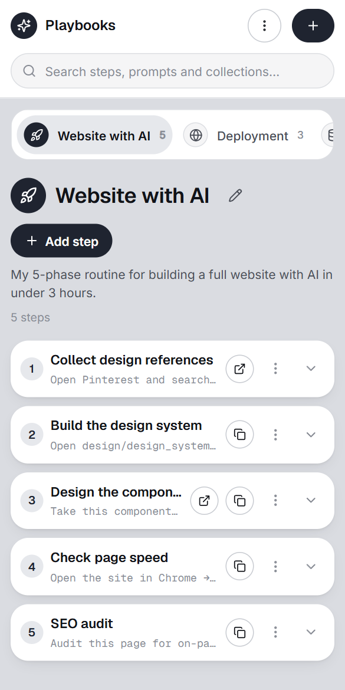

# Playbooks

**A personal library of the steps and prompts you reuse.** Save a how-to you keep forgetting, paste-ready AI prompts, and the links that go with them. Then find them, copy them and get on with your work.

It runs from a single HTML file: no install, no server, no account, no build step.



## Why

When you work with AI tools, you end up reusing the same prompts and following the same small routines: *"open this site, search that, download into a folder named X, then paste this prompt"*. Notes apps make long prompts take over the page, and chat history is impossible to search.

Playbooks keeps each of those as a **step**: one short row that you open when you need it, with a one-click **Copy**.

## Features

- **Steps that stay compact.** Every step is one row with a preview. Long prompts sit in a fixed-height box that scrolls inside the card, so a 60-line prompt doesn't push everything else off the screen.
- **Any mix in one step:**
  - **Actions:** a numbered "do this" list. Write `` `Design System Reference` `` and it becomes a click-to-copy chip (handy for folder names and search words). `[Pinterest](pinterest.com)` becomes a link.
  - **Prompt:** the exact text to paste into an AI tool. **Copy** works straight from the row.
  - **Links:** websites to open, with the first one a click away on the row.
- **Collections** with icons to group your steps (Deployment, AI prompts, Design…).
- **Fast editing** in a dialog. Each step's ⋮ menu has Duplicate, Move up/down and Delete, and every delete has **Undo**.
- **Search everything** with `/`, across titles, notes, actions, prompts and links.
- **Make it yours.** An **Appearance** panel offers 8 palettes, 4 list styles, sidebar and top-bar styles, card styles, corners, fonts and more, all applied live.
- **Backup** to a `.json` file and restore it on any machine.
- **Works on a phone** too.

| Edit a step | Appearance |
|---|---|
|  |  |

| Another look (Teal, dark bars) | On a phone |
|---|---|
|  |  |

## Get started

1. Download or clone this repo.
2. Open **`website/index.html`** in Chrome or Edge, by double-clicking it.
3. Edit the sample collections, or delete them and add your own.

Keyboard: **`/`** search · **`Esc`** clear or close · **`Ctrl + Enter`** save in a dialog · **`Enter`** next action while editing.

## Your data stays yours

- Everything you add is saved **in your browser's local storage** on your machine, as soon as you change it.
- Nothing is uploaded and there is no tracking. **This repository contains none of your data.** Anyone who downloads it gets the app with sample content only.
- Clearing your browser data erases your playbooks, so use **⋮ → Export backup** from time to time.

## Project structure

```
website/            the app: open index.html
  css/theme.css     every color, font, radius and spacing value + all palettes
  css/app.css       layout and components
  js/               small plain scripts (store, view, dialogs, appearance, backup…)
design/             Pencil design system and the reference images it was built from
docs/               design spec and the screenshots above
tests/              end-to-end test (Playwright) and the screenshot generator
```

It's built with plain HTML, CSS and JavaScript. It uses classic scripts on a shared `window.PB` namespace instead of ES modules, because browsers block modules on `file://` pages. [website/README.md](website/README.md) has the full code map and how to add a palette or icon.

## Tests

```bash
cd tests
npm install
npm test                 # 59 end-to-end checks against website/index.html
node screenshots.js      # regenerate docs/screenshots from the sample data
```

If Playwright's own browser isn't installed, point `PW_CHROME` at a Chrome or Chromium executable.
